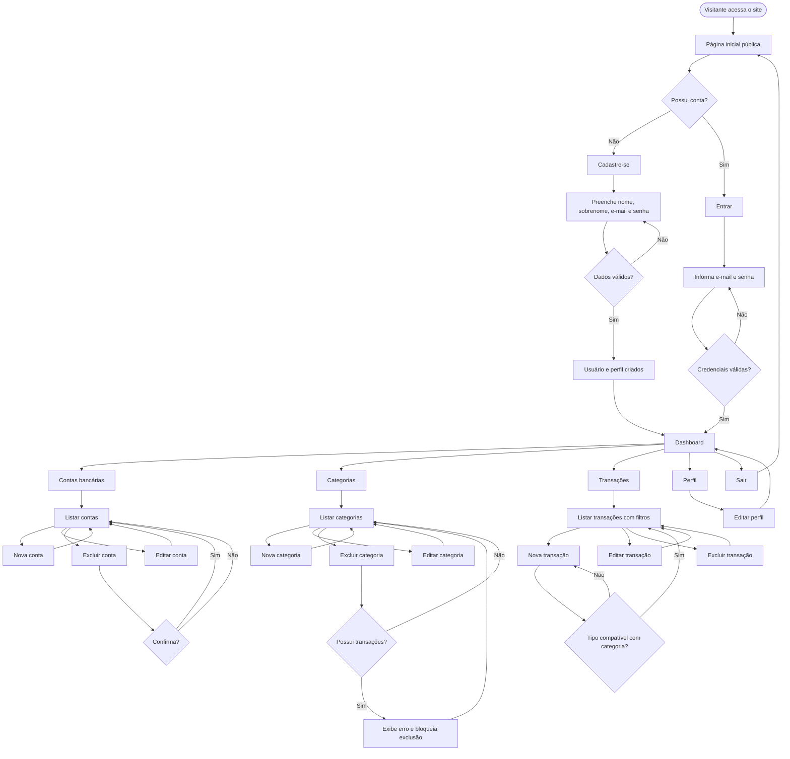
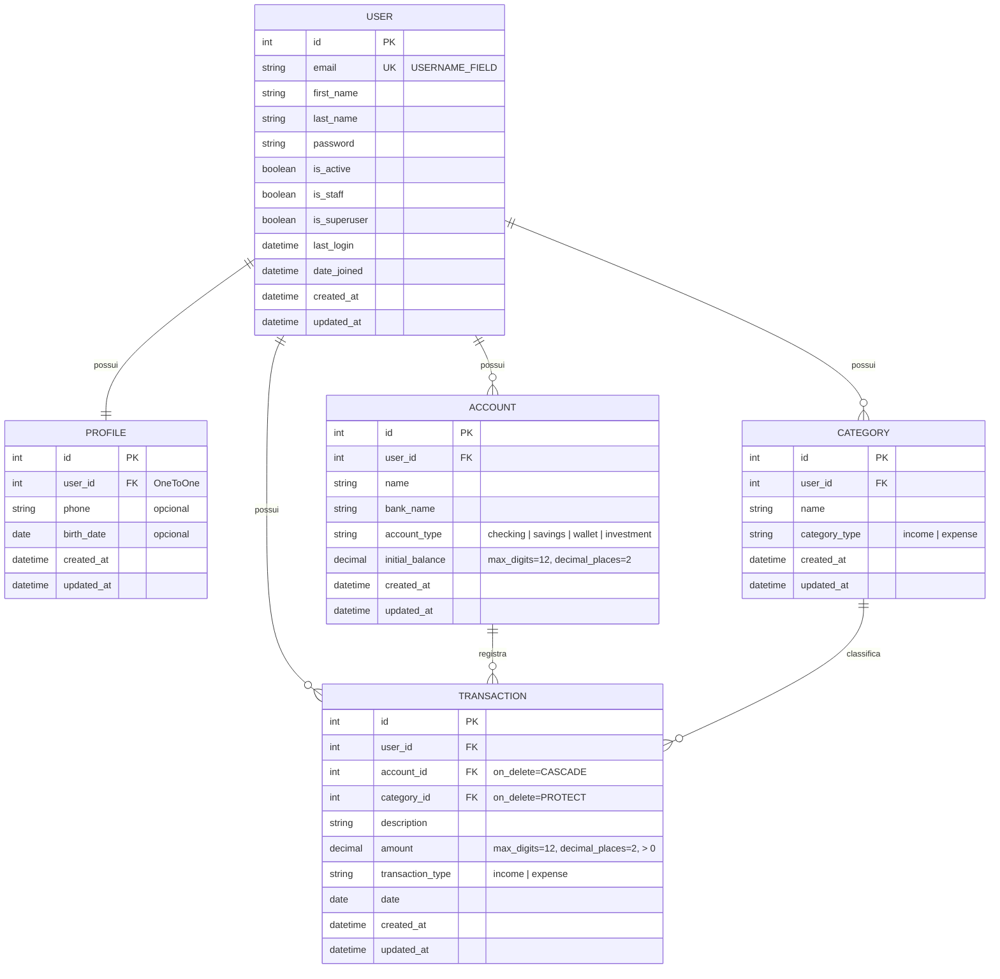

# PRD — Finanpy

> Sistema de gestão de finanças pessoais
> Versão do documento: 1.0 • Data: 03/11/2026

---

## 1. Visão geral

O **Finanpy** é uma aplicação web de gestão de finanças pessoais, construída em **Python + Django full stack**, com frontend renderizado pelo **Django Template Language (DTL)** e estilizado com **TailwindCSS**. O usuário cadastra suas contas bancárias, organiza categorias de lançamentos e registra transações de entrada e saída, acompanhando tudo em um dashboard consolidado.

O projeto segue a premissa de **simplicidade e ausência de over engineering**: recursos nativos do Django, Class Based Views, banco SQLite padrão e nenhuma funcionalidade além do escopo descrito neste documento.

---

## 2. Sobre o produto

| Item | Descrição |
|---|---|
| Nome | Finanpy |
| Tipo | Aplicação web (SSR — server side rendering) |
| Plataforma | Navegador (desktop, tablet e mobile — responsivo) |
| Idioma da interface | Português brasileiro |
| Idioma do código | Inglês |
| Autenticação | Sistema nativo do Django, login por **e-mail** |
| Banco de dados | SQLite padrão do Django |

**Módulos do produto:**

1. **Site público** — página de apresentação com chamadas para "Cadastre-se" e "Entrar".
2. **Autenticação** — cadastro, login (por e-mail) e logout.
3. **Perfil** — dados complementares do usuário.
4. **Contas bancárias** — cadastro e acompanhamento de saldo das contas.
5. **Categorias** — classificação de transações em categorias de entrada ou saída.
6. **Transações** — registro de entradas e saídas vinculadas a uma conta e uma categoria.
7. **Dashboard** — visão consolidada após o login.

---

## 3. Propósito

Oferecer uma forma **simples, rápida e visualmente agradável** de controlar as finanças pessoais, permitindo que o usuário saiba quanto tem, quanto entrou, quanto saiu e para onde foi o seu dinheiro, sem a complexidade de ferramentas financeiras robustas.

---

## 4. Público alvo

- Pessoas físicas que desejam organizar receitas e despesas pessoais.
- Usuários que possuem uma ou mais contas bancárias e querem uma visão consolidada.
- Pessoas que hoje controlam finanças em planilhas e buscam uma ferramenta mais organizada.
- Perfil técnico: usuários comuns de internet, sem necessidade de conhecimento financeiro avançado.

---

## 5. Objetivos

1. Permitir o cadastro e login do usuário usando **e-mail e senha**.
2. Permitir o gerenciamento (CRUD) de **contas bancárias**.
3. Permitir o gerenciamento (CRUD) de **categorias** de entrada e saída.
4. Permitir o gerenciamento (CRUD) de **transações** de entrada e saída.
5. Exibir um **dashboard** com saldo total, entradas e saídas do mês e últimas transações.
6. Garantir que cada usuário acesse **somente os próprios dados**.
7. Entregar uma interface **moderna, escura, responsiva e consistente**, baseada em um design system único.
8. Manter um código **simples, legível, PEP 8, com aspas simples** e baseado em recursos nativos do Django.

---

## 6. Requisitos funcionais

### 6.1 Site público

| ID | Requisito |
|---|---|
| RF01 | O sistema deve ter uma página inicial pública de apresentação do produto. |
| RF02 | A página inicial deve exibir os botões "Cadastre-se" e "Entrar". |
| RF03 | Usuário já autenticado que acessar a página inicial deve ver o botão "Ir para o dashboard". |

### 6.2 Autenticação (app `users`)

| ID | Requisito |
|---|---|
| RF04 | O usuário deve se cadastrar informando nome, sobrenome, e-mail, senha e confirmação de senha. |
| RF05 | O e-mail deve ser único no sistema. |
| RF06 | O login deve ser feito com **e-mail e senha** (sem username). |
| RF07 | Após o cadastro, o usuário deve ser autenticado automaticamente e redirecionado ao dashboard. |
| RF08 | Após o login, o usuário deve ser redirecionado ao dashboard. |
| RF09 | O usuário deve poder sair do sistema (logout), sendo redirecionado à página inicial. |
| RF10 | Páginas internas devem exigir autenticação; usuários anônimos são redirecionados ao login. |

### 6.3 Perfil (app `profiles`)

| ID | Requisito |
|---|---|
| RF11 | Um perfil deve ser criado automaticamente ao cadastrar um usuário (via signal). |
| RF12 | O usuário deve poder visualizar e editar seu perfil (nome, sobrenome, telefone e data de nascimento). |

### 6.4 Contas bancárias (app `accounts`)

| ID | Requisito |
|---|---|
| RF13 | O usuário deve poder cadastrar contas bancárias com nome, banco, tipo e saldo inicial. |
| RF14 | O usuário deve poder listar, editar e excluir suas contas. |
| RF15 | O saldo atual de cada conta deve ser calculado como: saldo inicial + entradas − saídas. |
| RF16 | Tipos de conta: Conta corrente, Poupança, Carteira, Investimento. |

### 6.5 Categorias (app `categories`)

| ID | Requisito |
|---|---|
| RF17 | O usuário deve poder cadastrar categorias com nome e tipo (Entrada ou Saída). |
| RF18 | O usuário deve poder listar, editar e excluir suas categorias. |
| RF19 | Não deve ser possível excluir uma categoria vinculada a transações (proteção de integridade). |

### 6.6 Transações (app `transactions`)

| ID | Requisito |
|---|---|
| RF20 | O usuário deve poder registrar transações com descrição, valor, tipo, data, conta e categoria. |
| RF21 | O tipo da transação deve ser compatível com o tipo da categoria selecionada. |
| RF22 | O usuário deve poder listar, editar e excluir suas transações. |
| RF23 | A listagem deve ser ordenada da data mais recente para a mais antiga e paginada. |
| RF24 | A listagem deve permitir filtro simples por mês/ano e por tipo (Entrada/Saída). |
| RF25 | Nos formulários, só devem aparecer contas e categorias do próprio usuário. |

### 6.7 Dashboard

| ID | Requisito |
|---|---|
| RF26 | Exibir o saldo total consolidado de todas as contas. |
| RF27 | Exibir o total de entradas e o total de saídas do mês corrente. |
| RF28 | Exibir o saldo de cada conta. |
| RF29 | Exibir as 5 últimas transações. |
| RF30 | Exibir atalhos para "Nova transação", "Nova conta" e "Nova categoria". |

### 6.8 Feedback ao usuário

| ID | Requisito |
|---|---|
| RF31 | Ações de criação, edição e exclusão devem exibir mensagens de sucesso (Django messages framework). |
| RF32 | Exclusões devem passar por uma página de confirmação. |

### 6.9 Flowchart de UX



---

## 7. Requisitos não-funcionais

| ID | Requisito |
|---|---|
| RNF01 | Utilizar Django full stack com templates DTL; sem frameworks JavaScript de frontend. |
| RNF02 | Estilização exclusivamente com TailwindCSS. |
| RNF03 | Interface responsiva (mobile first), com fundo escuro, gradientes e paleta harmônica. |
| RNF04 | Todas as telas devem seguir o mesmo design system e componentes. |
| RNF05 | Todo texto visível ao usuário em português brasileiro. |
| RNF06 | Todo o código (variáveis, classes, funções, models, URLs) em inglês. |
| RNF07 | Código seguindo PEP 8 e utilizando aspas simples sempre que possível. |
| RNF08 | Priorizar Class Based Views e recursos nativos do Django. |
| RNF09 | Banco de dados SQLite padrão do Django. |
| RNF10 | Todo model deve possuir `created_at` (`auto_now_add=True`) e `updated_at` (`auto_now=True`). |
| RNF11 | Signals devem ficar em `signals.py` dentro do app correspondente. |
| RNF12 | Isolamento de dados: toda consulta de dados do usuário deve ser filtrada por `request.user`. |
| RNF13 | Proteção CSRF em todos os formulários (nativo do Django). |
| RNF14 | Senhas validadas pelos `AUTH_PASSWORD_VALIDATORS` nativos. |
| RNF15 | Valores monetários com `DecimalField` (nunca `float`). |
| RNF16 | Formatação de datas e valores no padrão brasileiro (`pt-br`, `America/Sao_Paulo`). |
| RNF17 | Docker e testes automatizados somente nas sprints finais. |
| RNF18 | Não adicionar dependências ou funcionalidades fora do escopo deste documento. |

---

## 8. Arquitetura técnica

### 8.1 Stack

| Camada | Tecnologia |
|---|---|
| Linguagem | Python 3.12+ |
| Framework | Django 5.x |
| Frontend | Django Template Language |
| Estilo | TailwindCSS (via CDN `@tailwindcss/browser@4` no template base) |
| Fonte | Inter (Google Fonts) |
| Banco de dados | SQLite (padrão do Django) |
| Autenticação | `django.contrib.auth` com model de usuário customizado (login por e-mail) |
| Mensagens | `django.contrib.messages` |
| Admin | `django.contrib.admin` |

### 8.2 Estrutura de diretórios

```
finanpy
├── accounts            # contas bancárias
│   ├── forms.py
│   ├── models.py
│   ├── urls.py
│   └── views.py
├── categories          # categorias de transações
│   ├── forms.py
│   ├── models.py
│   ├── urls.py
│   └── views.py
├── core                # configurações globais
│   ├── forms.py        # StyledFormMixin (classes Tailwind nos widgets)
│   ├── settings.py
│   ├── urls.py
│   └── views.py        # HomeView e DashboardView
├── profiles            # perfis de usuários
│   ├── forms.py
│   ├── models.py
│   ├── signals.py      # cria Profile ao criar User
│   ├── urls.py
│   └── views.py
├── transactions        # entradas e saídas
│   ├── forms.py
│   ├── models.py
│   ├── urls.py
│   └── views.py
├── users               # usuário customizado (login por e-mail)
│   ├── forms.py
│   ├── managers.py
│   ├── models.py
│   ├── urls.py
│   └── views.py
├── templates
│   ├── base.html               # layout base (head, Tailwind, fontes, componentes)
│   ├── base_app.html           # layout autenticado (sidebar + topbar)
│   ├── components
│   │   ├── _form_field.html
│   │   ├── _messages.html
│   │   ├── _navbar_public.html
│   │   ├── _sidebar.html
│   │   ├── _empty_state.html
│   │   └── _pagination.html
│   ├── home.html
│   ├── dashboard.html
│   ├── users/ ...
│   ├── profiles/ ...
│   ├── accounts/ ...
│   ├── categories/ ...
│   └── transactions/ ...
├── db.sqlite3
└── manage.py
```

### 8.3 Mapa de URLs

| URL | View | Nome |
|---|---|---|
| `/` | `HomeView` (TemplateView) | `home` |
| `/dashboard/` | `DashboardView` | `dashboard` |
| `/signup/` | `SignUpView` (CreateView) | `signup` |
| `/login/` | `UserLoginView` (LoginView) | `login` |
| `/logout/` | `LogoutView` (POST) | `logout` |
| `/profile/` | `ProfileUpdateView` | `profile` |
| `/accounts/` | `AccountListView` | `account_list` |
| `/accounts/new/` | `AccountCreateView` | `account_create` |
| `/accounts/<pk>/edit/` | `AccountUpdateView` | `account_update` |
| `/accounts/<pk>/delete/` | `AccountDeleteView` | `account_delete` |
| `/categories/` ... | mesmo padrão CRUD | `category_*` |
| `/transactions/` ... | mesmo padrão CRUD | `transaction_*` |

### 8.4 Estrutura de dados (schemas)



**Regras de dados:**

- `User.email` é único e é o `USERNAME_FIELD`; o campo `username` é removido (`username = None`) com manager customizado em `users/managers.py`.
- `Category` possui `unique_together` (`user`, `name`, `category_type`).
- `Account.balance` é uma **propriedade calculada** (`initial_balance + soma(entradas) − soma(saídas)`), sem campo persistido e sem signals.
- `Transaction.amount` é sempre positivo; o sinal é dado por `transaction_type`.
- Exclusão de conta exclui suas transações (`CASCADE`); exclusão de categoria com transações é bloqueada (`PROTECT`).

---

## 9. Design system

### 9.1 Princípios

- **Escuro por padrão**: fundo quase preto azulado, superfícies em camadas.
- **Gradiente como identidade**: violeta → índigo → ciano em elementos de destaque (logo, botões primários, títulos, cards de saldo).
- **Semântica de cor**: verde-esmeralda para entradas, rosa para saídas.
- **Consistência**: todos os componentes definidos uma única vez como classes em `base.html` e reutilizados em todas as telas.

### 9.2 Paleta de cores

| Token | Uso | Classe Tailwind | Hex |
|---|---|---|---|
| `bg-app` | Fundo da aplicação | `bg-slate-950` | `#020617` |
| `bg-surface` | Cards, sidebar, modais | `bg-slate-900` | `#0F172A` |
| `bg-surface-2` | Inputs, hover de linhas | `bg-slate-800` | `#1E293B` |
| `border` | Bordas sutis | `border-slate-800` | `#1E293B` |
| `primary` | Ações principais | `violet-500` / `violet-600` | `#8B5CF6` / `#7C3AED` |
| `secondary` | Destaques secundários | `indigo-500` | `#6366F1` |
| `accent` | Detalhes, links | `cyan-400` | `#22D3EE` |
| `success` / entrada | Valores positivos | `emerald-400` | `#34D399` |
| `danger` / saída | Valores negativos, exclusão | `rose-500` | `#F43F5E` |
| `warning` | Alertas | `amber-400` | `#FBBF24` |
| `text-primary` | Texto principal | `text-slate-100` | `#F1F5F9` |
| `text-secondary` | Texto de apoio | `text-slate-400` | `#94A3B8` |
| `text-muted` | Placeholders, legendas | `text-slate-500` | `#64748B` |

**Gradientes:**

| Nome | Classes |
|---|---|
| Gradiente principal | `bg-gradient-to-r from-violet-600 via-indigo-600 to-cyan-500` |
| Gradiente de texto | `bg-gradient-to-r from-violet-400 to-cyan-400 bg-clip-text text-transparent` |
| Glow de fundo (hero) | `bg-gradient-to-br from-violet-600/20 via-slate-950 to-cyan-500/10` |
| Card de saldo | `bg-gradient-to-br from-violet-600 to-indigo-700` |

### 9.3 Tipografia

- Fonte: **Inter** (pesos 400, 500, 600, 700) via Google Fonts, aplicada em `body` com `font-['Inter']`.

| Elemento | Classes |
|---|---|
| H1 (página) | `text-2xl md:text-3xl font-bold text-slate-100` |
| H2 (seção) | `text-xl font-semibold text-slate-100` |
| H3 (card) | `text-sm font-medium text-slate-400 uppercase tracking-wide` |
| Corpo | `text-sm md:text-base text-slate-300` |
| Legenda | `text-xs text-slate-500` |
| Valor monetário grande | `text-3xl font-bold tabular-nums` |

### 9.4 Componentes (definidos em `base.html`)

Os componentes são declarados uma única vez em um bloco `<style type="text/tailwindcss">` no `base.html`, usando `@apply`:

```html
<style type="text/tailwindcss">
  @layer components {
    /* Botões */
    .btn { @apply inline-flex items-center justify-center gap-2 rounded-xl px-4 py-2.5 text-sm font-semibold transition focus:outline-none focus:ring-2 focus:ring-violet-500/50 disabled:opacity-50; }
    .btn-primary { @apply btn bg-gradient-to-r from-violet-600 via-indigo-600 to-cyan-500 text-white shadow-lg shadow-violet-900/40 hover:brightness-110; }
    .btn-secondary { @apply btn border border-slate-700 bg-slate-800 text-slate-100 hover:bg-slate-700; }
    .btn-ghost { @apply btn text-slate-300 hover:bg-slate-800 hover:text-white; }
    .btn-danger { @apply btn bg-rose-600 text-white hover:bg-rose-500; }

    /* Formulários */
    .form-label { @apply mb-1.5 block text-sm font-medium text-slate-300; }
    .form-input { @apply w-full rounded-xl border border-slate-700 bg-slate-800/70 px-4 py-2.5 text-slate-100 placeholder-slate-500 transition focus:border-violet-500 focus:outline-none focus:ring-2 focus:ring-violet-500/30; }
    .form-error { @apply mt-1 text-xs text-rose-400; }
    .form-help { @apply mt-1 text-xs text-slate-500; }

    /* Cards */
    .card { @apply rounded-2xl border border-slate-800 bg-slate-900/80 p-5 md:p-6 shadow-xl shadow-black/20; }

    /* Badges */
    .badge { @apply inline-flex items-center rounded-full px-2.5 py-0.5 text-xs font-medium; }
    .badge-income { @apply badge bg-emerald-500/10 text-emerald-400 ring-1 ring-emerald-500/30; }
    .badge-expense { @apply badge bg-rose-500/10 text-rose-400 ring-1 ring-rose-500/30; }

    /* Tabelas */
    .table { @apply w-full text-left text-sm; }
    .table th { @apply border-b border-slate-800 px-4 py-3 text-xs font-medium uppercase tracking-wide text-slate-500; }
    .table td { @apply border-b border-slate-800/60 px-4 py-3 text-slate-300; }
    .table tr:hover td { @apply bg-slate-800/40; }

    /* Menu lateral */
    .nav-link { @apply flex items-center gap-3 rounded-xl px-3 py-2.5 text-sm font-medium text-slate-400 transition hover:bg-slate-800 hover:text-white; }
    .nav-link-active { @apply nav-link bg-gradient-to-r from-violet-600/20 to-cyan-500/10 text-white ring-1 ring-violet-500/30; }
  }
</style>
```

### 9.5 Padrões de botões

| Variante | Uso |
|---|---|
| `btn-primary` | Ação principal da tela (Salvar, Nova transação, Entrar, Cadastre-se) |
| `btn-secondary` | Ações secundárias (Cancelar, Voltar, Filtrar) |
| `btn-ghost` | Ações discretas em tabelas (Editar) e itens de menu |
| `btn-danger` | Ações destrutivas (Excluir, Confirmar exclusão) |

Regra: no máximo **um** `btn-primary` por tela/formulário.

### 9.6 Inputs e forms

- Todos os campos recebem a classe `form-input` automaticamente via `StyledFormMixin` (`core/forms.py`), que percorre `self.fields` no `__init__` e aplica `widget.attrs['class'] = 'form-input'`.
- Cada campo é renderizado pelo partial `components/_form_field.html` (label + input + help text + erros).
- Formulários ficam dentro de um `card`, com largura máxima `max-w-xl` e espaçamento `space-y-5`.
- Rodapé do formulário: `flex justify-end gap-3` com `btn-secondary` (Cancelar) e `btn-primary` (Salvar).
- Erros gerais (`non_field_errors`) exibidos no topo do form em caixa `rounded-xl bg-rose-500/10 text-rose-300 p-3`.

### 9.7 Grids e layout

| Contexto | Classes |
|---|---|
| Container de página | `mx-auto w-full max-w-7xl px-4 md:px-8 py-6 md:py-8` |
| Cards de resumo (dashboard) | `grid grid-cols-1 sm:grid-cols-2 lg:grid-cols-3 gap-4 md:gap-6` |
| Conteúdo dois blocos | `grid grid-cols-1 lg:grid-cols-3 gap-6` (principal `lg:col-span-2`) |
| Cabeçalho de página | `flex flex-col sm:flex-row sm:items-center sm:justify-between gap-4 mb-6` |
| Listas em mobile | Tabela com `overflow-x-auto` dentro de `card` |

### 9.8 Menus

- **Área pública** (`_navbar_public.html`): barra superior fixa, `backdrop-blur bg-slate-950/70 border-b border-slate-800`, logo em gradiente à esquerda e botões "Entrar" (`btn-ghost`) e "Cadastre-se" (`btn-primary`) à direita.
- **Área autenticada** (`_sidebar.html`): sidebar fixa à esquerda em `lg` (`w-64 bg-slate-900 border-r border-slate-800`), com itens: Dashboard, Transações, Contas, Categorias, Perfil e, no rodapé, Sair (form POST). Em telas menores, a sidebar fica oculta e é aberta por um botão "menu" na topbar (toggle simples com poucas linhas de JavaScript inline).
- Item ativo usa `nav-link-active` (comparação com `request.resolver_match.url_name`).

### 9.9 Feedback e estados

- **Mensagens** (`_messages.html`): alertas no topo do conteúdo; sucesso `bg-emerald-500/10 text-emerald-300 ring-1 ring-emerald-500/30`, erro `bg-rose-500/10 text-rose-300 ring-1 ring-rose-500/30`.
- **Estado vazio** (`_empty_state.html`): ícone, texto explicativo e `btn-primary` para criar o primeiro registro.
- **Valores**: entradas em `text-emerald-400` com prefixo `+`, saídas em `text-rose-400` com prefixo `−`, sempre `tabular-nums`.

---

## 10. User stories

### Épico 1 — Acesso e autenticação

**US01** — Como visitante, quero ver uma página de apresentação para entender o que é o Finanpy.
- [ ] A página `/` é acessível sem login.
- [ ] Exibe título, descrição do produto e botões "Cadastre-se" e "Entrar".
- [ ] É responsiva e segue o design system.

**US02** — Como visitante, quero me cadastrar com meu e-mail para começar a usar o sistema.
- [ ] Formulário com nome, sobrenome, e-mail, senha e confirmação de senha.
- [ ] E-mail duplicado exibe erro "Já existe um usuário com este e-mail."
- [ ] Senhas fracas ou divergentes exibem erros em português.
- [ ] Após cadastro, sou autenticado e levado ao dashboard.
- [ ] Um perfil é criado automaticamente.

**US03** — Como usuário, quero entrar com e-mail e senha.
- [ ] O campo de login é rotulado "E-mail".
- [ ] Credenciais inválidas exibem mensagem de erro sem revelar qual campo está errado.
- [ ] Após login, sou redirecionado ao dashboard.

**US04** — Como usuário, quero sair do sistema.
- [ ] O botão "Sair" encerra a sessão via POST.
- [ ] Sou redirecionado à página inicial.

### Épico 2 — Perfil

**US05** — Como usuário, quero editar meus dados pessoais.
- [ ] Posso alterar nome, sobrenome, telefone e data de nascimento.
- [ ] Vejo mensagem "Perfil atualizado com sucesso."

### Épico 3 — Contas bancárias

**US06** — Como usuário, quero cadastrar minhas contas bancárias.
- [ ] Informo nome, banco, tipo e saldo inicial.
- [ ] A conta aparece na listagem com saldo atual calculado.

**US07** — Como usuário, quero editar e excluir minhas contas.
- [ ] Só vejo e altero contas minhas (acesso a conta de outro usuário retorna 404).
- [ ] A exclusão exige confirmação e avisa que as transações da conta também serão excluídas.

### Épico 4 — Categorias

**US08** — Como usuário, quero criar categorias de entrada e saída.
- [ ] Informo nome e tipo.
- [ ] Não posso ter duas categorias com mesmo nome e tipo.

**US09** — Como usuário, quero editar e excluir categorias.
- [ ] Categoria com transações não pode ser excluída; vejo mensagem explicativa.

### Épico 5 — Transações

**US10** — Como usuário, quero registrar uma entrada ou saída.
- [ ] Informo descrição, valor, tipo, data, conta e categoria.
- [ ] Só vejo minhas contas e categorias nos selects.
- [ ] Valor deve ser maior que zero.
- [ ] Categoria deve ser do mesmo tipo da transação.
- [ ] A data vem preenchida com o dia atual.

**US11** — Como usuário, quero ver e filtrar minhas transações.
- [ ] Lista ordenada por data decrescente, paginada (20 por página).
- [ ] Filtro por mês/ano e por tipo.
- [ ] Entradas em verde, saídas em rosa.

**US12** — Como usuário, quero editar e excluir transações.
- [ ] Alterações refletem imediatamente no saldo das contas e no dashboard.

### Épico 6 — Dashboard

**US13** — Como usuário, quero uma visão geral das minhas finanças.
- [ ] Vejo saldo total, entradas do mês e saídas do mês.
- [ ] Vejo saldo por conta.
- [ ] Vejo as 5 últimas transações.
- [ ] Vejo atalhos para criar transação, conta e categoria.
- [ ] Sem dados, vejo estados vazios com chamada para ação.

---

## 11. Métricas de sucesso

### 11.1 KPIs de produto

| KPI | Meta |
|---|---|
| Taxa de conversão visitante → cadastro | ≥ 15% |
| Taxa de ativação (usuário cria 1 conta + 1 transação em até 24h) | ≥ 60% |
| Tempo médio para registrar uma transação | ≤ 30 segundos |
| Telas seguindo 100% do design system | 100% |

### 11.2 KPIs de usuário

| KPI | Meta |
|---|---|
| Usuários ativos semanais (WAU) / total de usuários | ≥ 40% |
| Média de transações registradas por usuário ativo / semana | ≥ 5 |
| Retenção após 30 dias | ≥ 30% |
| Média de contas cadastradas por usuário | ≥ 2 |

### 11.3 KPIs técnicos

| KPI | Meta |
|---|---|
| Tempo de resposta das páginas (p95) | ≤ 500 ms |
| Erros 500 em produção | 0 por semana |
| Vazamento de dados entre usuários | 0 ocorrências |
| Conformidade PEP 8 (flake8/ruff) | 100% |
| Cobertura de testes (sprint de testes) | ≥ 80% |

---

## 12. Riscos e mitigações

| # | Risco | Impacto | Mitigação |
|---|---|---|---|
| R1 | Trocar o model de usuário após a primeira migration | Alto | Criar `users.User` e definir `AUTH_USER_MODEL` **antes** do primeiro `migrate`. |
| R2 | Usuário acessar dados de outro usuário | Alto | Sobrescrever `get_queryset()` em todas as views filtrando por `request.user`; mixin `UserQuerySetMixin`. |
| R3 | Erros de arredondamento em valores | Médio | Usar `DecimalField` e `Sum` do ORM; nunca `float`. |
| R4 | Tailwind via CDN não é otimizado para produção | Médio | Aceitável para o escopo inicial; reavaliar build com Tailwind CLI na sprint de Docker/deploy. |
| R5 | Inconsistência visual entre telas | Médio | Componentes centralizados em `base.html` e partials; revisão visual ao fim de cada sprint. |
| R6 | Saldo incorreto por dados duplicados | Médio | Saldo calculado dinamicamente (sem campo persistido). |
| R7 | Exclusão acidental de dados | Médio | Páginas de confirmação; `PROTECT` em categorias. |
| R8 | Limitação de concorrência do SQLite | Baixo | Uso pessoal com baixa concorrência; adequado ao escopo. |
| R9 | Escopo crescer além do solicitado | Médio | Seguir estritamente este PRD; novas ideias vão para backlog futuro. |
| R10 | Ausência de testes nas sprints iniciais | Médio | Testes manuais com checklist ao fim de cada sprint; testes automatizados na sprint 9. |

---

## 13. Lista de tarefas

> Marque com `X` conforme o andamento: `[ ]` pendente • `[X]` concluído.

### Sprint 0 — Setup do projeto

- [ ] **0.1 Ambiente**
  - [X] 0.1.1 Criar o diretório `finanpy` e o ambiente virtual (`python -m venv .venv`).
  - [X] 0.1.2 Ativar o ambiente virtual e instalar Django 5.x (`pip install django`).
  - [X] 0.1.3 Gerar `requirements.txt` com `pip freeze > requirements.txt`.
  - [X] 0.1.4 Criar `.gitignore` (`.venv/`, `__pycache__/`, `db.sqlite3`, `*.pyc`, `.env`).
  - [ ] 0.1.5 Inicializar repositório git e fazer o primeiro commit.
- [X] **0.2 Projeto Django**
  - [X] 0.2.1 Criar o projeto com `django-admin startproject core .`.
  - [X] 0.2.2 Criar os apps: `python manage.py startapp users`, `profiles`, `accounts`, `categories`, `transactions`.
  - [X] 0.2.3 Registrar os 5 apps em `INSTALLED_APPS` (usando `'<app>.apps.<App>Config'`).
  - [X] 0.2.4 Ajustar o `name` de cada `AppConfig` e definir `verbose_name` em português (ex.: `'Contas bancárias'`).
- [X] **0.3 Configurações globais (`core/settings.py`)**
  - [X] 0.3.1 Definir `LANGUAGE_CODE = 'pt-br'` (idioma padrão), `LANGUAGES = [('pt-br', 'Português (Brasil)'), ('en-us', 'English (US)')]` e `TIME_ZONE = 'America/Sao_Paulo'`.
  - [X] 0.3.2 Manter `USE_I18N = True` e `USE_TZ = True`.
  - [X] 0.3.3 Configurar `TEMPLATES['DIRS'] = [BASE_DIR / 'templates']`.
  - [X] 0.3.4 Confirmar `DATABASES` com SQLite padrão.
  - [X] 0.3.5 Converter todas as strings do `settings.py` para aspas simples.
  - [X] 0.3.6 Criar o diretório `templates/` e `templates/components/`.
- [X] **0.4 Padrões de código**
  - [X] 0.4.1 Documentar no `README.md` as convenções: inglês no código, pt-BR na UI, aspas simples, PEP 8.
  - [X] 0.4.2 Revisar arquivos gerados pelo `startproject`/`startapp` trocando aspas duplas por simples.

### Sprint 1 — Usuário customizado e base de dados de autenticação

- [ ] **1.1 Manager de usuário (`users/managers.py`)**
  - [ ] 1.1.1 Criar `UserManager(BaseUserManager)`.
  - [ ] 1.1.2 Implementar `create_user(email, password=None, **extra_fields)` com `normalize_email` e validação de e-mail obrigatório.
  - [ ] 1.1.3 Implementar `create_superuser` definindo `is_staff=True` e `is_superuser=True`.
- [ ] **1.2 Model `User` (`users/models.py`)**
  - [ ] 1.2.1 Criar `User(AbstractUser)` com `username = None`.
  - [ ] 1.2.2 Definir `email = models.EmailField('e-mail', unique=True)`.
  - [ ] 1.2.3 Adicionar `created_at` e `updated_at`.
  - [ ] 1.2.4 Definir `USERNAME_FIELD = 'email'` e `REQUIRED_FIELDS = ['first_name', 'last_name']`.
  - [ ] 1.2.5 Atribuir `objects = UserManager()`.
  - [ ] 1.2.6 Definir `Meta` com `verbose_name = 'usuário'` e `verbose_name_plural = 'usuários'`.
  - [ ] 1.2.7 Implementar `__str__` retornando o e-mail.
- [ ] **1.3 Configuração e migrations**
  - [ ] 1.3.1 Definir `AUTH_USER_MODEL = 'users.User'` no `settings.py`.
  - [ ] 1.3.2 Rodar `makemigrations users` e `migrate` (primeira migration do projeto).
  - [ ] 1.3.3 Criar superusuário com `createsuperuser` e validar login por e-mail no admin.
- [ ] **1.4 Admin de usuários (`users/admin.py`)**
  - [ ] 1.4.1 Registrar `User` com `UserAdmin` customizado.
  - [ ] 1.4.2 Ajustar `ordering = ('email',)`, `list_display` (email, first_name, last_name, is_staff).
  - [ ] 1.4.3 Ajustar `fieldsets` e `add_fieldsets` removendo `username`.
  - [ ] 1.4.4 Definir `search_fields = ('email', 'first_name', 'last_name')`.

### Sprint 2 — Design system e templates base

- [ ] **2.1 Template base (`templates/base.html`)**
  - [ ] 2.1.1 Estrutura HTML5 com `lang="pt-br"`, meta viewport e charset.
  - [ ] 2.1.2 Incluir o script do Tailwind CDN (`@tailwindcss/browser@4`).
  - [ ] 2.1.3 Incluir a fonte Inter via Google Fonts.
  - [ ] 2.1.4 Definir `body` com `bg-slate-950 text-slate-100 font-['Inter'] antialiased min-h-screen`.
  - [ ] 2.1.5 Adicionar bloco `<style type="text/tailwindcss">` com os componentes da seção 9.4.
  - [ ] 2.1.6 Criar blocos ``, `` e ``.
- [ ] **2.2 Layout autenticado (`templates/base_app.html`)**
  - [ ] 2.2.1 Estender `base.html` e montar estrutura `flex` com sidebar + área de conteúdo.
  - [ ] 2.2.2 Criar topbar mobile com logo e botão de abrir menu.
  - [ ] 2.2.3 Incluir `_messages.html` no topo do conteúdo.
  - [ ] 2.2.4 Envolver o conteúdo no container padrão (seção 9.7).
- [ ] **2.3 Componentes (partials)**
  - [ ] 2.3.1 `_sidebar.html`: logo em gradiente, links do menu e botão Sair (form POST com `csrf_token`).
  - [ ] 2.3.2 Lógica de item ativo com `request.resolver_match.url_name`.
  - [ ] 2.3.3 Script inline mínimo para abrir/fechar sidebar no mobile.
  - [ ] 2.3.4 `_navbar_public.html`: logo, "Entrar" e "Cadastre-se" (ou "Ir para o dashboard" se autenticado).
  - [ ] 2.3.5 `_messages.html`: renderizar `messages` com cores por `message.tags`.
  - [ ] 2.3.6 `_form_field.html`: label, campo, help text e lista de erros.
  - [ ] 2.3.7 `_empty_state.html`: recebe `text`, `button_label` e `button_url` via ``.
  - [ ] 2.3.8 `_pagination.html`: anterior/próxima e página atual, preservando querystring de filtros.
- [ ] **2.4 Mixin de formulários (`core/forms.py`)**
  - [ ] 2.4.1 Criar `StyledFormMixin` aplicando `form-input` a todos os widgets.
  - [ ] 2.4.2 Tratar `CheckboxInput` com classe própria (`h-4 w-4 accent-violet-500`).
  - [ ] 2.4.3 Configurar `DateInput` com `type='date'` onde aplicável (nos forms dos apps).
- [ ] **2.5 Página inicial pública**
  - [ ] 2.5.1 Criar `HomeView(TemplateView)` em `core/views.py`.
  - [ ] 2.5.2 Criar `templates/home.html` estendendo `base.html` com navbar pública.
  - [ ] 2.5.3 Seção hero: título com gradiente de texto, subtítulo e botões "Cadastre-se" e "Entrar".
  - [ ] 2.5.4 Seção de destaques com 3 cards (Contas, Categorias, Transações) em grid responsivo.
  - [ ] 2.5.5 Rodapé simples com nome do produto e ano.
  - [ ] 2.5.6 Registrar rota `''` com `name='home'` em `core/urls.py`.
- [ ] **2.6 Validação visual**
  - [ ] 2.6.1 Conferir a home em 375px, 768px e 1280px.
  - [ ] 2.6.2 Conferir contraste dos textos sobre o fundo escuro.

### Sprint 3 — Cadastro, login e logout

- [ ] **3.1 Formulários (`users/forms.py`)**
  - [ ] 3.1.1 Criar `SignUpForm(StyledFormMixin, UserCreationForm)` com `model = User` e `fields = ('first_name', 'last_name', 'email')`.
  - [ ] 3.1.2 Definir labels em português (Nome, Sobrenome, E-mail, Senha, Confirmação de senha).
  - [ ] 3.1.3 Tornar `first_name` e `last_name` obrigatórios.
  - [ ] 3.1.4 Criar `LoginForm(StyledFormMixin, AuthenticationForm)` com label "E-mail" no campo `username`.
  - [ ] 3.1.5 Personalizar a mensagem de erro de credenciais inválidas em português.
- [ ] **3.2 Views (`users/views.py`)**
  - [ ] 3.2.1 Criar `SignUpView(CreateView)` com `SignUpForm` e template `users/signup.html`.
  - [ ] 3.2.2 Em `form_valid`, salvar o usuário e chamar `login()` antes do redirecionamento.
  - [ ] 3.2.3 Definir `success_url = reverse_lazy('dashboard')`.
  - [ ] 3.2.4 Redirecionar usuário já autenticado que acessar `/signup/` para o dashboard.
  - [ ] 3.2.5 Criar `UserLoginView(LoginView)` com `LoginForm`, template `users/login.html` e `redirect_authenticated_user = True`.
  - [ ] 3.2.6 Usar `LogoutView` nativa (POST).
- [ ] **3.3 URLs e settings**
  - [ ] 3.3.1 Criar `users/urls.py` com `signup`, `login` e `logout`.
  - [ ] 3.3.2 Incluir `users.urls` em `core/urls.py`.
  - [ ] 3.3.3 Definir `LOGIN_URL = 'login'`, `LOGIN_REDIRECT_URL = 'dashboard'` e `LOGOUT_REDIRECT_URL = 'home'`.
- [ ] **3.4 Templates**
  - [ ] 3.4.1 `users/signup.html`: card centralizado, logo, título "Crie sua conta", campos e botão "Cadastrar".
  - [ ] 3.4.2 Link "Já tem conta? Entrar" no rodapé do card.
  - [ ] 3.4.3 `users/login.html`: card centralizado, título "Bem-vindo de volta", campos e botão "Entrar".
  - [ ] 3.4.4 Link "Ainda não tem conta? Cadastre-se" no rodapé do card.
  - [ ] 3.4.5 Fundo com glow em gradiente (seção 9.2) nas duas telas.
- [ ] **3.5 Dashboard provisório**
  - [ ] 3.5.1 Criar `DashboardView(LoginRequiredMixin, TemplateView)` em `core/views.py`.
  - [ ] 3.5.2 Criar `templates/dashboard.html` estendendo `base_app.html` com título "Dashboard".
  - [ ] 3.5.3 Registrar rota `dashboard/` com `name='dashboard'`.
- [ ] **3.6 Validação manual**
  - [ ] 3.6.1 Cadastrar usuário novo e confirmar redirecionamento ao dashboard.
  - [ ] 3.6.2 Tentar cadastrar e-mail duplicado e conferir mensagem.
  - [ ] 3.6.3 Fazer logout e login com e-mail.
  - [ ] 3.6.4 Acessar `/dashboard/` deslogado e confirmar redirecionamento ao login.

### Sprint 4 — Perfil

- [ ] **4.1 Model `Profile` (`profiles/models.py`)**
  - [ ] 4.1.1 Criar `Profile` com `user = OneToOneField(settings.AUTH_USER_MODEL, on_delete=CASCADE, related_name='profile')`.
  - [ ] 4.1.2 Adicionar `phone` (`CharField`, `max_length=20`, `blank=True`).
  - [ ] 4.1.3 Adicionar `birth_date` (`DateField`, `null=True`, `blank=True`).
  - [ ] 4.1.4 Adicionar `created_at` e `updated_at`.
  - [ ] 4.1.5 Definir `verbose_name` em português e `__str__`.
  - [ ] 4.1.6 Rodar `makemigrations profiles` e `migrate`.
- [ ] **4.2 Signal (`profiles/signals.py`)**
  - [ ] 4.2.1 Criar receiver `post_save` para `User` que cria o `Profile` quando `created=True`.
  - [ ] 4.2.2 Importar o módulo de signals no método `ready()` de `ProfilesConfig`.
  - [ ] 4.2.3 Validar criação automática cadastrando um novo usuário.
  - [ ] 4.2.4 Criar perfil para o superusuário existente via shell/admin.
- [ ] **4.3 Admin**
  - [ ] 4.3.1 Registrar `Profile` com `list_display = ('user', 'phone', 'birth_date')`.
- [ ] **4.4 Edição de perfil**
  - [ ] 4.4.1 Criar `ProfileForm(StyledFormMixin, ModelForm)` com `phone` e `birth_date` (input `type='date'`).
  - [ ] 4.4.2 Criar `UserNameForm(StyledFormMixin, ModelForm)` com `first_name` e `last_name`.
  - [ ] 4.4.3 Criar `ProfileUpdateView(LoginRequiredMixin, View)` tratando GET e POST dos dois forms juntos.
  - [ ] 4.4.4 Exibir mensagem "Perfil atualizado com sucesso." e redirecionar para o próprio perfil.
  - [ ] 4.4.5 Criar `profiles/urls.py` com rota `profile/` e incluir em `core/urls.py`.
  - [ ] 4.4.6 Criar `profiles/profile_form.html` com card, e-mail exibido como somente leitura e botão "Salvar".
  - [ ] 4.4.7 Adicionar link "Perfil" na sidebar.

### Sprint 5 — Contas bancárias

- [ ] **5.1 Model `Account` (`accounts/models.py`)**
  - [ ] 5.1.1 Criar `AccountType(models.TextChoices)`: `CHECKING='checking','Conta corrente'`, `SAVINGS='savings','Poupança'`, `WALLET='wallet','Carteira'`, `INVESTMENT='investment','Investimento'`.
  - [ ] 5.1.2 Criar `Account` com `user` (FK, `related_name='accounts'`).
  - [ ] 5.1.3 Adicionar `name` (`max_length=100`) e `bank_name` (`max_length=100`, `blank=True`).
  - [ ] 5.1.4 Adicionar `account_type` com `choices` e default `CHECKING`.
  - [ ] 5.1.5 Adicionar `initial_balance` (`DecimalField(max_digits=12, decimal_places=2, default=0)`).
  - [ ] 5.1.6 Adicionar `created_at` e `updated_at`.
  - [ ] 5.1.7 Definir `Meta.ordering = ['name']` e `verbose_name` em português.
  - [ ] 5.1.8 Implementar `__str__` retornando o nome.
  - [ ] 5.1.9 Rodar `makemigrations accounts` e `migrate`.
- [ ] **5.2 Admin**
  - [ ] 5.2.1 Registrar `Account` com `list_display`, `list_filter = ('account_type',)` e `search_fields`.
- [ ] **5.3 Mixin de isolamento por usuário**
  - [ ] 5.3.1 Criar `UserQuerySetMixin` em `core/views.py` que filtra `get_queryset()` por `user=self.request.user`.
  - [ ] 5.3.2 Documentar no README que toda view de dados do usuário deve usar `LoginRequiredMixin` + `UserQuerySetMixin`.
- [ ] **5.4 Formulário**
  - [ ] 5.4.1 Criar `AccountForm(StyledFormMixin, ModelForm)` com `name`, `bank_name`, `account_type`, `initial_balance`.
  - [ ] 5.4.2 Definir labels em português (Nome, Banco, Tipo, Saldo inicial).
- [ ] **5.5 Views**
  - [ ] 5.5.1 `AccountListView` (`LoginRequiredMixin`, `UserQuerySetMixin`, `ListView`).
  - [ ] 5.5.2 `AccountCreateView` atribuindo `form.instance.user = self.request.user` em `form_valid`.
  - [ ] 5.5.3 `AccountUpdateView` com queryset filtrado por usuário.
  - [ ] 5.5.4 `AccountDeleteView` com página de confirmação.
  - [ ] 5.5.5 Usar `SuccessMessageMixin` com mensagens: "Conta criada com sucesso.", "Conta atualizada com sucesso.".
  - [ ] 5.5.6 Exibir mensagem "Conta excluída com sucesso." no `form_valid` da exclusão.
- [ ] **5.6 URLs**
  - [ ] 5.6.1 Criar `accounts/urls.py` com `account_list`, `account_create`, `account_update`, `account_delete`.
  - [ ] 5.6.2 Incluir em `core/urls.py` sob o prefixo `accounts/`.
- [ ] **5.7 Templates**
  - [ ] 5.7.1 `accounts/account_list.html`: cabeçalho com título "Contas" e botão "Nova conta".
  - [ ] 5.7.2 Grid de cards de conta (nome, banco, tipo em badge, saldo atual) com ações Editar/Excluir.
  - [ ] 5.7.3 Estado vazio "Você ainda não cadastrou nenhuma conta."
  - [ ] 5.7.4 `accounts/account_form.html` reutilizado para criar e editar (título dinâmico).
  - [ ] 5.7.5 `accounts/account_confirm_delete.html` com aviso de exclusão das transações vinculadas.
  - [ ] 5.7.6 Adicionar link "Contas" na sidebar.
- [ ] **5.8 Validação manual**
  - [ ] 5.8.1 CRUD completo de contas.
  - [ ] 5.8.2 Tentar acessar `/accounts/<pk>/edit/` de outro usuário e confirmar 404.

### Sprint 6 — Categorias

- [ ] **6.1 Model `Category` (`categories/models.py`)**
  - [ ] 6.1.1 Criar `CategoryType(models.TextChoices)`: `INCOME='income','Entrada'`, `EXPENSE='expense','Saída'`.
  - [ ] 6.1.2 Criar `Category` com `user` (FK, `related_name='categories'`), `name` (`max_length=100`) e `category_type`.
  - [ ] 6.1.3 Adicionar `created_at` e `updated_at`.
  - [ ] 6.1.4 Definir `Meta.ordering = ['category_type', 'name']`.
  - [ ] 6.1.5 Definir `UniqueConstraint(fields=['user', 'name', 'category_type'], name='unique_user_category')`.
  - [ ] 6.1.6 Implementar `__str__` retornando o nome.
  - [ ] 6.1.7 Rodar `makemigrations categories` e `migrate`.
- [ ] **6.2 Admin**
  - [ ] 6.2.1 Registrar com `list_display = ('name', 'category_type', 'user')` e `list_filter`.
- [ ] **6.3 Formulário**
  - [ ] 6.3.1 Criar `CategoryForm(StyledFormMixin, ModelForm)` com `name` e `category_type`.
  - [ ] 6.3.2 Receber `user` no `__init__` e validar duplicidade no `clean()` com mensagem em português.
  - [ ] 6.3.3 Passar `user` via `get_form_kwargs()` nas views de criação e edição.
- [ ] **6.4 Views**
  - [ ] 6.4.1 `CategoryListView` separando entradas e saídas no contexto.
  - [ ] 6.4.2 `CategoryCreateView` atribuindo o usuário.
  - [ ] 6.4.3 `CategoryUpdateView` com queryset filtrado.
  - [ ] 6.4.4 `CategoryDeleteView` capturando `ProtectedError` e exibindo "Esta categoria possui transações e não pode ser excluída."
  - [ ] 6.4.5 Mensagens de sucesso para criar, editar e excluir.
- [ ] **6.5 URLs**
  - [ ] 6.5.1 Criar `categories/urls.py` com `category_list`, `category_create`, `category_update`, `category_delete`.
  - [ ] 6.5.2 Incluir em `core/urls.py` sob `categories/`.
- [ ] **6.6 Templates**
  - [ ] 6.6.1 `categories/category_list.html` com duas colunas (Entradas / Saídas) em grid responsivo.
  - [ ] 6.6.2 Cada item com badge de tipo e ações Editar/Excluir.
  - [ ] 6.6.3 Estado vazio por coluna.
  - [ ] 6.6.4 `categories/category_form.html` (criar/editar).
  - [ ] 6.6.5 `categories/category_confirm_delete.html`.
  - [ ] 6.6.6 Adicionar link "Categorias" na sidebar.
- [ ] **6.7 Validação manual**
  - [ ] 6.7.1 CRUD completo de categorias.
  - [ ] 6.7.2 Tentar criar categoria duplicada e conferir erro.

### Sprint 7 — Transações

- [ ] **7.1 Model `Transaction` (`transactions/models.py`)**
  - [ ] 7.1.1 Criar `TransactionType(models.TextChoices)`: `INCOME='income','Entrada'`, `EXPENSE='expense','Saída'`.
  - [ ] 7.1.2 Criar `Transaction` com `user` (FK, `related_name='transactions'`).
  - [ ] 7.1.3 Adicionar `account` (FK `Account`, `on_delete=CASCADE`, `related_name='transactions'`).
  - [ ] 7.1.4 Adicionar `category` (FK `Category`, `on_delete=PROTECT`, `related_name='transactions'`).
  - [ ] 7.1.5 Adicionar `description` (`max_length=200`), `amount` (`DecimalField(12, 2)` com `MinValueValidator(Decimal('0.01'))`).
  - [ ] 7.1.6 Adicionar `transaction_type` com choices e `date` (`DateField`, default `timezone.localdate`).
  - [ ] 7.1.7 Adicionar `created_at` e `updated_at`.
  - [ ] 7.1.8 Definir `Meta.ordering = ['-date', '-created_at']`.
  - [ ] 7.1.9 Implementar `__str__` com descrição e valor.
  - [ ] 7.1.10 Rodar `makemigrations transactions` e `migrate`.
- [ ] **7.2 Saldo da conta**
  - [ ] 7.2.1 Implementar a propriedade `Account.balance` usando `aggregate(Sum)` por tipo de transação.
  - [ ] 7.2.2 Tratar `None` do `Sum` com `Coalesce` ou `or Decimal('0')`.
- [ ] **7.3 Admin**
  - [ ] 7.3.1 Registrar com `list_display = ('date', 'description', 'transaction_type', 'amount', 'account', 'category', 'user')`.
  - [ ] 7.3.2 Adicionar `list_filter = ('transaction_type', 'date')` e `date_hierarchy = 'date'`.
- [ ] **7.4 Formulário**
  - [ ] 7.4.1 Criar `TransactionForm(StyledFormMixin, ModelForm)` com `description`, `amount`, `transaction_type`, `date`, `account`, `category`.
  - [ ] 7.4.2 Receber `user` no `__init__` e filtrar `account.queryset` e `category.queryset` pelo usuário.
  - [ ] 7.4.3 Configurar `date` com `DateInput(attrs={'type': 'date'}, format='%Y-%m-%d')`.
  - [ ] 7.4.4 Validar no `clean()` que `category.category_type == transaction_type`, com erro "A categoria selecionada não corresponde ao tipo da transação."
  - [ ] 7.4.5 Definir labels em português (Descrição, Valor, Tipo, Data, Conta, Categoria).
- [ ] **7.5 Views**
  - [ ] 7.5.1 `TransactionListView` com `paginate_by = 20` e `select_related('account', 'category')`.
  - [ ] 7.5.2 Filtro por mês/ano via querystring (`?month=AAAA-MM`) aplicado em `get_queryset()`.
  - [ ] 7.5.3 Filtro por tipo via querystring (`?type=income|expense`).
  - [ ] 7.5.4 Enviar ao contexto os valores atuais dos filtros e os totais de entradas e saídas do resultado filtrado.
  - [ ] 7.5.5 `TransactionCreateView` passando `user` em `get_form_kwargs()` e atribuindo `form.instance.user`.
  - [ ] 7.5.6 `TransactionUpdateView` com queryset filtrado e `user` no form.
  - [ ] 7.5.7 `TransactionDeleteView` com página de confirmação.
  - [ ] 7.5.8 Mensagens de sucesso em português para criar, editar e excluir.
- [ ] **7.6 URLs**
  - [ ] 7.6.1 Criar `transactions/urls.py` com `transaction_list`, `transaction_create`, `transaction_update`, `transaction_delete`.
  - [ ] 7.6.2 Incluir em `core/urls.py` sob `transactions/`.
- [ ] **7.7 Templates**
  - [ ] 7.7.1 `transactions/transaction_list.html` com cabeçalho e botão "Nova transação".
  - [ ] 7.7.2 Barra de filtros (input `month`, select de tipo, botão "Filtrar" e link "Limpar").
  - [ ] 7.7.3 Cards de totais do filtro (Entradas / Saídas).
  - [ ] 7.7.4 Tabela com Data, Descrição, Categoria, Conta, Valor (cor por tipo) e Ações.
  - [ ] 7.7.5 Formatação de valores com `floatformat:2` e localização pt-BR (`USE_THOUSAND_SEPARATOR = True`).
  - [ ] 7.7.6 Incluir `_pagination.html` preservando filtros.
  - [ ] 7.7.7 Estado vazio "Nenhuma transação encontrada."
  - [ ] 7.7.8 `transactions/transaction_form.html` (criar/editar).
  - [ ] 7.7.9 `transactions/transaction_confirm_delete.html`.
  - [ ] 7.7.10 Adicionar link "Transações" na sidebar.
- [ ] **7.8 Validação manual**
  - [ ] 7.8.1 Criar entradas e saídas e conferir o saldo das contas.
  - [ ] 7.8.2 Tentar salvar transação com tipo incompatível com a categoria.
  - [ ] 7.8.3 Testar filtros e paginação.
  - [ ] 7.8.4 Tentar excluir categoria com transações e conferir bloqueio.

### Sprint 8 — Dashboard e refinamentos visuais

- [ ] **8.1 Dados do dashboard (`DashboardView.get_context_data`)**
  - [ ] 8.1.1 Buscar as contas do usuário e calcular o saldo total (soma de `balance`).
  - [ ] 8.1.2 Calcular o total de entradas do mês corrente com `aggregate(Sum)`.
  - [ ] 8.1.3 Calcular o total de saídas do mês corrente.
  - [ ] 8.1.4 Calcular o resultado do mês (entradas − saídas).
  - [ ] 8.1.5 Buscar as 5 últimas transações com `select_related`.
- [ ] **8.2 Template do dashboard**
  - [ ] 8.2.1 Saudação "Olá, {nome}" e mês corrente por extenso.
  - [ ] 8.2.2 Card de saldo total com gradiente (`bg-gradient-to-br from-violet-600 to-indigo-700`).
  - [ ] 8.2.3 Cards de entradas do mês (esmeralda) e saídas do mês (rosa).
  - [ ] 8.2.4 Bloco "Últimas transações" (tabela compacta) com link "Ver todas".
  - [ ] 8.2.5 Bloco "Minhas contas" com saldo por conta e link "Gerenciar".
  - [ ] 8.2.6 Atalhos "Nova transação", "Nova conta" e "Nova categoria".
  - [ ] 8.2.7 Estados vazios para usuário sem contas ou sem transações.
- [ ] **8.3 Revisão do design system**
  - [ ] 8.3.1 Revisar todas as telas garantindo uso exclusivo dos componentes definidos.
  - [ ] 8.3.2 Garantir um único `btn-primary` por tela.
  - [ ] 8.3.3 Revisar responsividade em 375px, 768px e 1280px em todas as telas.
  - [ ] 8.3.4 Revisar estados de foco dos inputs e botões (acessibilidade por teclado).
  - [ ] 8.3.5 Revisar todos os textos da interface (pt-BR, ortografia e consistência).
  - [ ] 8.3.6 Adicionar `` específico em cada página ("Transações | Finanpy").
- [ ] **8.4 Revisão de código**
  - [ ] 8.4.1 Conferir aspas simples em todos os arquivos Python.
  - [ ] 8.4.2 Rodar verificação PEP 8 (ex.: `ruff check` ou `flake8`) e corrigir apontamentos.
  - [ ] 8.4.3 Conferir que todas as views de dados usam `LoginRequiredMixin` + `UserQuerySetMixin`.
  - [ ] 8.4.4 Conferir que todos os models possuem `created_at` e `updated_at`.
  - [ ] 8.4.5 Atualizar o `README.md` com instruções de instalação e execução.

### Sprint 9 — Testes automatizados

- [ ] **9.1 Testes de `users`**
  - [ ] 9.1.1 `UserManager.create_user` cria usuário com e-mail normalizado.
  - [ ] 9.1.2 `create_user` sem e-mail levanta `ValueError`.
  - [ ] 9.1.3 `create_superuser` define `is_staff` e `is_superuser`.
  - [ ] 9.1.4 Cadastro válido cria usuário, autentica e redireciona ao dashboard.
  - [ ] 9.1.5 Cadastro com e-mail duplicado retorna erro no form.
  - [ ] 9.1.6 Login por e-mail funciona; login inválido exibe erro.
  - [ ] 9.1.7 Logout via POST redireciona para a home.
- [ ] **9.2 Testes de `profiles`**
  - [ ] 9.2.1 Signal cria `Profile` ao criar `User`.
  - [ ] 9.2.2 Edição de perfil atualiza `User` e `Profile`.
- [ ] **9.3 Testes de `accounts`**
  - [ ] 9.3.1 Cálculo de `balance` sem transações retorna o saldo inicial.
  - [ ] 9.3.2 Cálculo de `balance` com entradas e saídas.
  - [ ] 9.3.3 CRUD via views com usuário autenticado.
  - [ ] 9.3.4 Acesso a conta de outro usuário retorna 404.
- [ ] **9.4 Testes de `categories`**
  - [ ] 9.4.1 Restrição de duplicidade por usuário/nome/tipo.
  - [ ] 9.4.2 Exclusão de categoria com transações é bloqueada.
  - [ ] 9.4.3 Isolamento entre usuários.
- [ ] **9.5 Testes de `transactions`**
  - [ ] 9.5.1 Form rejeita valor menor ou igual a zero.
  - [ ] 9.5.2 Form rejeita categoria incompatível com o tipo.
  - [ ] 9.5.3 Form só lista contas e categorias do usuário.
  - [ ] 9.5.4 Filtros por mês e tipo retornam os registros corretos.
  - [ ] 9.5.5 Isolamento entre usuários.
- [ ] **9.6 Testes do dashboard e home**
  - [ ] 9.6.1 Home responde 200 para anônimos.
  - [ ] 9.6.2 Dashboard redireciona anônimos ao login.
  - [ ] 9.6.3 Totais do mês e saldo total calculados corretamente.
- [ ] **9.7 Cobertura**
  - [ ] 9.7.1 Instalar `coverage` e medir cobertura (`coverage run manage.py test`).
  - [ ] 9.7.2 Atingir cobertura mínima de 80%.

### Sprint 10 — Docker

- [ ] **10.1 Variáveis de ambiente**
  - [ ] 10.1.1 Ler `SECRET_KEY`, `DEBUG` e `ALLOWED_HOSTS` de variáveis de ambiente com `os.environ.get`.
  - [ ] 10.1.2 Criar `.env.example` documentando as variáveis.
- [ ] **10.2 Dockerfile**
  - [ ] 10.2.1 Criar `Dockerfile` baseado em `python:3.12-slim`.
  - [ ] 10.2.2 Instalar dependências a partir do `requirements.txt`.
  - [ ] 10.2.3 Rodar `collectstatic` no build.
  - [ ] 10.2.4 Definir comando de execução (`migrate` + servidor).
- [ ] **10.3 Docker Compose**
  - [ ] 10.3.1 Criar `docker-compose.yml` com o serviço `web`.
  - [ ] 10.3.2 Montar volume para persistir o `db.sqlite3`.
  - [ ] 10.3.3 Criar `.dockerignore`.
- [ ] **10.4 Documentação**
  - [ ] 10.4.1 Atualizar o `README.md` com instruções de execução via Docker.
  - [ ] 10.4.2 Validar a subida completa do sistema com `docker compose up`.
