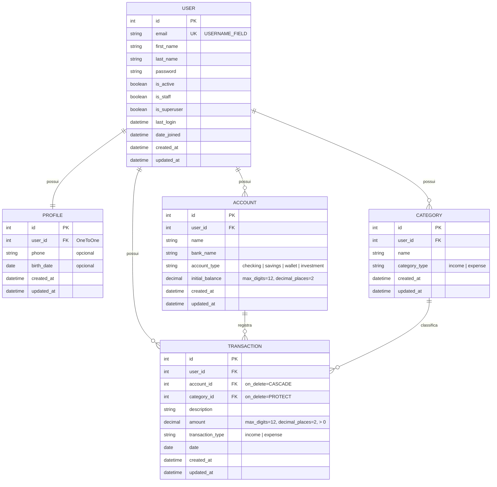

# PRD — Finanpy

> Sistema de gestão de finanças pessoais
> Versão do documento: 1.0 • Data: 03/11/2026

---

## 1. Visão geral

O **Finanpy** é uma aplicação web de gestão de finanças pessoais, construída em **Python + Django full stack**, com frontend renderizado pelo **Django Template Language (DTL)** e estilizado com **TailwindCSS**. O usuário cadastra suas contas bancárias, organiza categorias de lançamentos e registra transações de entrada e saída, acompanhando tudo em um dashboard consolidado.

O projeto segue a premissa de **simplicidade e ausência de over engineering**: recursos nativos do Django, Class Based Views, banco SQLite padrão e nenhuma funcionalidade além do escopo descrito neste documento.

---

## 2. Sobre o produto

| Item | Descrição |
|---|---|
| Nome | Finanpy |
| Tipo | Aplicação web (SSR — server side rendering) |
| Plataforma | Navegador (desktop, tablet e mobile — responsivo) |
| Idioma da interface | Português brasileiro |
| Idioma do código | Inglês |
| Autenticação | Sistema nativo do Django, login por **e-mail** |
| Banco de dados | SQLite padrão do Django |

**Módulos do produto:**

1. **Site público** — página de apresentação com chamadas para "Cadastre-se" e "Entrar".
2. **Autenticação** — cadastro, login (por e-mail) e logout.
3. **Perfil** — dados complementares do usuário.
4. **Contas bancárias** — cadastro e acompanhamento de saldo das contas.
5. **Categorias** — classificação de transações em categorias de entrada ou saída.
6. **Transações** — registro de entradas e saídas vinculadas a uma conta e uma categoria.
7. **Dashboard** — visão consolidada após o login.

---

## 3. Propósito

Oferecer uma forma **simples, rápida e visualmente agradável** de controlar as finanças pessoais, permitindo que o usuário saiba quanto tem, quanto entrou, quanto saiu e para onde foi o seu dinheiro, sem a complexidade de ferramentas financeiras robustas.

---

## 4. Público alvo

- Pessoas físicas que desejam organizar receitas e despesas pessoais.
- Usuários que possuem uma ou mais contas bancárias e querem uma visão consolidada.
- Pessoas que hoje controlam finanças em planilhas e buscam uma ferramenta mais organizada.
- Perfil técnico: usuários comuns de internet, sem necessidade de conhecimento financeiro avançado.

---

## 5. Objetivos

1. Permitir o cadastro e login do usuário usando **e-mail e senha**.
2. Permitir o gerenciamento (CRUD) de **contas bancárias**.
3. Permitir o gerenciamento (CRUD) de **categorias** de entrada e saída.
4. Permitir o gerenciamento (CRUD) de **transações** de entrada e saída.
5. Exibir um **dashboard** com saldo total, entradas e saídas do mês e últimas transações.
6. Garantir que cada usuário acesse **somente os próprios dados**.
7. Entregar uma interface **moderna, escura, responsiva e consistente**, baseada em um design system único.
8. Manter um código **simples, legível, PEP 8, com aspas simples** e baseado em recursos nativos do Django.

---

## 6. Requisitos funcionais

### 6.1 Site público

| ID | Requisito |
|---|---|
| RF01 | O sistema deve ter uma página inicial pública de apresentação do produto. |
| RF02 | A página inicial deve exibir os botões "Cadastre-se" e "Entrar". |
| RF03 | Usuário já autenticado que acessar a página inicial deve ver o botão "Ir para o dashboard". |

### 6.2 Autenticação (app `users`)

| ID | Requisito |
|---|---|
| RF04 | O usuário deve se cadastrar informando nome, sobrenome, e-mail, senha e confirmação de senha. |
| RF05 | O e-mail deve ser único no sistema. |
| RF06 | O login deve ser feito com **e-mail e senha** (sem username). |
| RF07 | Após o cadastro, o usuário deve ser autenticado automaticamente e redirecionado ao dashboard. |
| RF08 | Após o login, o usuário deve ser redirecionado ao dashboard. |
| RF09 | O usuário deve poder sair do sistema (logout), sendo redirecionado à página inicial. |
| RF10 | Páginas internas devem exigir autenticação; usuários anônimos são redirecionados ao login. |

### 6.3 Perfil (app `profiles`)

| ID | Requisito |
|---|---|
| RF11 | Um perfil deve ser criado automaticamente ao cadastrar um usuário (via signal). |
| RF12 | O usuário deve poder visualizar e editar seu perfil (nome, sobrenome, telefone e data de nascimento). |

### 6.4 Contas bancárias (app `accounts`)

| ID | Requisito |
|---|---|
| RF13 | O usuário deve poder cadastrar contas bancárias com nome, banco, tipo e saldo inicial. |
| RF14 | O usuário deve poder listar, editar e excluir suas contas. |
| RF15 | O saldo atual de cada conta deve ser calculado como: saldo inicial + entradas − saídas. |
| RF16 | Tipos de conta: Conta corrente, Poupança, Carteira, Investimento. |

### 6.5 Categorias (app `categories`)

| ID | Requisito |
|---|---|
| RF17 | O usuário deve poder cadastrar categorias com nome e tipo (Entrada ou Saída). |
| RF18 | O usuário deve poder listar, editar e excluir suas categorias. |
| RF19 | Não deve ser possível excluir uma categoria vinculada a transações (proteção de integridade). |

### 6.6 Transações (app `transactions`)

| ID | Requisito |
|---|---|
| RF20 | O usuário deve poder registrar transações com descrição, valor, tipo, data, conta e categoria. |
| RF21 | O tipo da transação deve ser compatível com o tipo da categoria selecionada. |
| RF22 | O usuário deve poder listar, editar e excluir suas transações. |
| RF23 | A listagem deve ser ordenada da data mais recente para a mais antiga e paginada. |
| RF24 | A listagem deve permitir filtro simples por mês/ano e por tipo (Entrada/Saída). |
| RF25 | Nos formulários, só devem aparecer contas e categorias do próprio usuário. |

### 6.7 Dashboard

| ID | Requisito |
|---|---|
| RF26 | Exibir o saldo total consolidado de todas as contas. |
| RF27 | Exibir o total de entradas e o total de saídas do mês corrente. |
| RF28 | Exibir o saldo de cada conta. |
| RF29 | Exibir as 5 últimas transações. |
| RF30 | Exibir atalhos para "Nova transação", "Nova conta" e "Nova categoria". |

### 6.8 Feedback ao usuário

| ID | Requisito |
|---|---|
| RF31 | Ações de criação, edição e exclusão devem exibir mensagens de sucesso (Django messages framework). |
| RF32 | Exclusões devem passar por uma página de confirmação. |

### 6.9 Flowchart de UX


---

## 7. Requisitos não-funcionais

| ID | Requisito |
|---|---|
| RNF01 | Utilizar Django full stack com templates DTL; sem frameworks JavaScript de frontend. |
| RNF02 | Estilização exclusivamente com TailwindCSS. |
| RNF03 | Interface responsiva (mobile first), com fundo escuro, gradientes e paleta harmônica. |
| RNF04 | Todas as telas devem seguir o mesmo design system e componentes. |
| RNF05 | Todo texto visível ao usuário em português brasileiro. |
| RNF06 | Todo o código (variáveis, classes, funções, models, URLs) em inglês. |
| RNF07 | Código seguindo PEP 8 e utilizando aspas simples sempre que possível. |
| RNF08 | Priorizar Class Based Views e recursos nativos do Django. |
| RNF09 | Banco de dados SQLite padrão do Django. |
| RNF10 | Todo model deve possuir `created_at` (`auto_now_add=True`) e `updated_at` (`auto_now=True`). |
| RNF11 | Signals devem ficar em `signals.py` dentro do app correspondente. |
| RNF12 | Isolamento de dados: toda consulta de dados do usuário deve ser filtrada por `request.user`. |
| RNF13 | Proteção CSRF em todos os formulários (nativo do Django). |
| RNF14 | Senhas validadas pelos `AUTH_PASSWORD_VALIDATORS` nativos. |
| RNF15 | Valores monetários com `DecimalField` (nunca `float`). |
| RNF16 | Formatação de datas e valores no padrão brasileiro (`pt-br`, `America/Sao_Paulo`). |
| RNF17 | Docker e testes automatizados somente nas sprints finais. |
| RNF18 | Não adicionar dependências ou funcionalidades fora do escopo deste documento. |

---

## 8. Arquitetura técnica

### 8.1 Stack

| Camada | Tecnologia |
|---|---|
| Linguagem | Python 3.12+ |
| Framework | Django 5.x |
| Frontend | Django Template Language |
| Estilo | TailwindCSS (via CDN `@tailwindcss/browser@4` no template base) |
| Fonte | Inter (Google Fonts) |
| Banco de dados | SQLite (padrão do Django) |
| Autenticação | `django.contrib.auth` com model de usuário customizado (login por e-mail) |
| Mensagens | `django.contrib.messages` |
| Admin | `django.contrib.admin` |

### 8.2 Estrutura de diretórios

```
finanpy
├── accounts            # contas bancárias
│   ├── forms.py
│   ├── models.py
│   ├── urls.py
│   └── views.py
├── categories          # categorias de transações
│   ├── forms.py
│   ├── models.py
│   ├── urls.py
│   └── views.py
├── core                # configurações globais
│   ├── forms.py        # StyledFormMixin (classes Tailwind nos widgets)
│   ├── settings.py
│   ├── urls.py
│   └── views.py        # HomeView e DashboardView
├── profiles            # perfis de usuários
│   ├── forms.py
│   ├── models.py
│   ├── signals.py      # cria Profile ao criar User
│   ├── urls.py
│   └── views.py
├── transactions        # entradas e saídas
│   ├── forms.py
│   ├── models.py
│   ├── urls.py
│   └── views.py
├── users               # usuário customizado (login por e-mail)
│   ├── forms.py
│   ├── managers.py
│   ├── models.py
│   ├── urls.py
│   └── views.py
├── templates
│   ├── base.html               # layout base (head, Tailwind, fontes, componentes)
│   ├── base_app.html           # layout autenticado (sidebar + topbar)
│   ├── components
│   │   ├── _form_field.html
│   │   ├── _messages.html
│   │   ├── _navbar_public.html
│   │   ├── _sidebar.html
│   │   ├── _empty_state.html
│   │   └── _pagination.html
│   ├── home.html
│   ├── dashboard.html
│   ├── users/ ...
│   ├── profiles/ ...
│   ├── accounts/ ...
│   ├── categories/ ...
│   └── transactions/ ...
├── db.sqlite3
└── manage.py
```

### 8.3 Mapa de URLs

| URL | View | Nome |
|---|---|---|
| `/` | `HomeView` (TemplateView) | `home` |
| `/dashboard/` | `DashboardView` | `dashboard` |
| `/signup/` | `SignUpView` (CreateView) | `signup` |
| `/login/` | `UserLoginView` (LoginView) | `login` |
| `/logout/` | `LogoutView` (POST) | `logout` |
| `/profile/` | `ProfileUpdateView` | `profile` |
| `/accounts/` | `AccountListView` | `account_list` |
| `/accounts/new/` | `AccountCreateView` | `account_create` |
| `/accounts/<pk>/edit/` | `AccountUpdateView` | `account_update` |
| `/accounts/<pk>/delete/` | `AccountDeleteView` | `account_delete` |
| `/categories/` ... | mesmo padrão CRUD | `category_*` |
| `/transactions/` ... | mesmo padrão CRUD | `transaction_*` |

### 8.4 Estrutura de dados (schemas)



**Regras de dados:**

- `User.email` é único e é o `USERNAME_FIELD`; o campo `username` é removido (`username = None`) com manager customizado em `users/managers.py`.
- `Category` possui `unique_together` (`user`, `name`, `category_type`).
- `Account.balance` é uma **propriedade calculada** (`initial_balance + soma(entradas) − soma(saídas)`), sem campo persistido e sem signals.
- `Transaction.amount` é sempre positivo; o sinal é dado por `transaction_type`.
- Exclusão de conta exclui suas transações (`CASCADE`); exclusão de categoria com transações é bloqueada (`PROTECT`).

---

## 9. Design system

### 9.1 Princípios

- **Escuro por padrão**: fundo quase preto azulado, superfícies em camadas.
- **Gradiente como identidade**: violeta → índigo → ciano em elementos de destaque (logo, botões primários, títulos, cards de saldo).
- **Semântica de cor**: verde-esmeralda para entradas, rosa para saídas.
- **Consistência**: todos os componentes definidos uma única vez como classes em `base.html` e reutilizados em todas as telas.

### 9.2 Paleta de cores

| Token | Uso | Classe Tailwind | Hex |
|---|---|---|---|
| `bg-app` | Fundo da aplicação | `bg-slate-950` | `#020617` |
| `bg-surface` | Cards, sidebar, modais | `bg-slate-900` | `#0F172A` |
| `bg-surface-2` | Inputs, hover de linhas | `bg-slate-800` | `#1E293B` |
| `border` | Bordas sutis | `border-slate-800` | `#1E293B` |
| `primary` | Ações principais | `violet-500` / `violet-600` | `#8B5CF6` / `#7C3AED` |
| `secondary` | Destaques secundários | `indigo-500` | `#6366F1` |
| `accent` | Detalhes, links | `cyan-400` | `#22D3EE` |
| `success` / entrada | Valores positivos | `emerald-400` | `#34D399` |
| `danger` / saída | Valores negativos, exclusão | `rose-500` | `#F43F5E` |
| `warning` | Alertas | `amber-400` | `#FBBF24` |
| `text-primary` | Texto principal | `text-slate-100` | `#F1F5F9` |
| `text-secondary` | Texto de apoio | `text-slate-400` | `#94A3B8` |
| `text-muted` | Placeholders, legendas | `text-slate-500` | `#64748B` |

**Gradientes:**

| Nome | Classes |
|---|---|
| Gradiente principal | `bg-gradient-to-r from-violet-600 via-indigo-600 to-cyan-500` |
| Gradiente de texto | `bg-gradient-to-r from-violet-400 to-cyan-400 bg-clip-text text-transparent` |
| Glow de fundo (hero) | `bg-gradient-to-br from-violet-600/20 via-slate-950 to-cyan-500/10` |
| Card de saldo | `bg-gradient-to-br from-violet-600 to-indigo-700` |

### 9.3 Tipografia

- Fonte: **Inter** (pesos 400, 500, 600, 700) via Google Fonts, aplicada em `body` com `font-['Inter']`.

| Elemento | Classes |
|---|---|
| H1 (página) | `text-2xl md:text-3xl font-bold text-slate-100` |
| H2 (seção) | `text-xl font-semibold text-slate-100` |
| H3 (card) | `text-sm font-medium text-slate-400 uppercase tracking-wide` |
| Corpo | `text-sm md:text-base text-slate-300` |
| Legenda | `text-xs text-slate-500` |
| Valor monetário grande | `text-3xl font-bold tabular-nums` |

### 9.4 Componentes (definidos em `base.html`)

Os componentes são declarados uma única vez em um bloco `<style type="text/tailwindcss">` no `base.html`, usando `@apply`:

```html
<style type="text/tailwindcss">
  @layer components {
    /* Botões */
    .btn { @apply inline-flex items-center justify-center gap-2 rounded-xl px-4 py-2.5 text-sm font-semibold transition focus:outline-none focus:ring-2 focus:ring-violet-500/50 disabled:opacity-50; }
    .btn-primary { @apply btn bg-gradient-to-r from-violet-600 via-indigo-600 to-cyan-500 text-white shadow-lg shadow-violet-900/40 hover:brightness-110; }
    .btn-secondary { @apply btn border border-slate-700 bg-slate-800 text-slate-100 hover:bg-slate-700; }
    .btn-ghost { @apply btn text-slate-300 hover:bg-slate-800 hover:text-white; }
    .btn-danger { @apply btn bg-rose-600 text-white hover:bg-rose-500; }

    /* Formulários */
    .form-label { @apply mb-1.5 block text-sm font-medium text-slate-300; }
    .form-input { @apply w-full rounded-xl border border-slate-700 bg-slate-800/70 px-4 py-2.5 text-slate-100 placeholder-slate-500 transition focus:border-violet-500 focus:outline-none focus:ring-2 focus:ring-violet-500/30; }
    .form-error { @apply mt-1 text-xs text-rose-400; }
    .form-help { @apply mt-1 text-xs text-slate-500; }

    /* Cards */
    .card { @apply rounded-2xl border border-slate-800 bg-slate-900/80 p-5 md:p-6 shadow-xl shadow-black/20; }

    /* Badges */
    .badge { @apply inline-flex items-center rounded-full px-2.5 py-0.5 text-xs font-medium; }
    .badge-income { @apply badge bg-emerald-500/10 text-emerald-400 ring-1 ring-emerald-500/30; }
    .badge-expense { @apply badge bg-rose-500/10 text-rose-400 ring-1 ring-rose-500/30; }

    /* Tabelas */
    .table { @apply w-full text-left text-sm; }
    .table th { @apply border-b border-slate-800 px-4 py-3 text-xs font-medium uppercase tracking-wide text-slate-500; }
    .table td { @apply border-b border-slate-800/60 px-4 py-3 text-slate-300; }
    .table tr:hover td { @apply bg-slate-800/40; }

    /* Menu lateral */
    .nav-link { @apply flex items-center gap-3 rounded-xl px-3 py-2.5 text-sm font-medium text-slate-400 transition hover:bg-slate-800 hover:text-white; }
    .nav-link-active { @apply nav-link bg-gradient-to-r from-violet-600/20 to-cyan-500/10 text-white ring-1 ring-violet-500/30; }
  }
</style>
```

### 9.5 Padrões de botões

| Variante | Uso |
|---|---|
| `btn-primary` | Ação principal da tela (Salvar, Nova transação, Entrar, Cadastre-se) |
| `btn-secondary` | Ações secundárias (Cancelar, Voltar, Filtrar) |
| `btn-ghost` | Ações discretas em tabelas (Editar) e itens de menu |
| `btn-danger` | Ações destrutivas (Excluir, Confirmar exclusão) |

Regra: no máximo **um** `btn-primary` por tela/formulário.

### 9.6 Inputs e forms

- Todos os campos recebem a classe `form-input` automaticamente via `StyledFormMixin` (`core/forms.py`), que percorre `self.fields` no `__init__` e aplica `widget.attrs['class'] = 'form-input'`.
- Cada campo é renderizado pelo partial `components/_form_field.html` (label + input + help text + erros).
- Formulários ficam dentro de um `card`, com largura máxima `max-w-xl` e espaçamento `space-y-5`.
- Rodapé do formulário: `flex justify-end gap-3` com `btn-secondary` (Cancelar) e `btn-primary` (Salvar).
- Erros gerais (`non_field_errors`) exibidos no topo do form em caixa `rounded-xl bg-rose-500/10 text-rose-300 p-3`.

### 9.7 Grids e layout

| Contexto | Classes |
|---|---|
| Container de página | `mx-auto w-full max-w-7xl px-4 md:px-8 py-6 md:py-8` |
| Cards de resumo (dashboard) | `grid grid-cols-1 sm:grid-cols-2 lg:grid-cols-3 gap-4 md:gap-6` |
| Conteúdo dois blocos | `grid grid-cols-1 lg:grid-cols-3 gap-6` (principal `lg:col-span-2`) |
| Cabeçalho de página | `flex flex-col sm:flex-row sm:items-center sm:justify-between gap-4 mb-6` |
| Listas em mobile | Tabela com `overflow-x-auto` dentro de `card` |

### 9.8 Menus

- **Área pública** (`_navbar_public.html`): barra superior fixa, `backdrop-blur bg-slate-950/70 border-b border-slate-800`, logo em gradiente à esquerda e botões "Entrar" (`btn-ghost`) e "Cadastre-se" (`btn-primary`) à direita.
- **Área autenticada** (`_sidebar.html`): sidebar fixa à esquerda em `lg` (`w-64 bg-slate-900 border-r border-slate-800`), com itens: Dashboard, Transações, Contas, Categorias, Perfil e, no rodapé, Sair (form POST). Em telas menores, a sidebar fica oculta e é aberta por um botão "menu" na topbar (toggle simples com poucas linhas de JavaScript inline).
- Item ativo usa `nav-link-active` (comparação com `request.resolver_match.url_name`).

### 9.9 Feedback e estados

- **Mensagens** (`_messages.html`): alertas no topo do conteúdo; sucesso `bg-emerald-500/10 text-emerald-300 ring-1 ring-emerald-500/30`, erro `bg-rose-500/10 text-rose-300 ring-1 ring-rose-500/30`.
- **Estado vazio** (`_empty_state.html`): ícone, texto explicativo e `btn-primary` para criar o primeiro registro.
- **Valores**: entradas em `text-emerald-400` com prefixo `+`, saídas em `text-rose-400` com prefixo `−`, sempre `tabular-nums`.

---

## 10. User stories

### Épico 1 — Acesso e autenticação

**US01** — Como visitante, quero ver uma página de apresentação para entender o que é o Finanpy.
- [ ] A página `/` é acessível sem login.
- [ ] Exibe título, descrição do produto e botões "Cadastre-se" e "Entrar".
- [ ] É responsiva e segue o design system.

**US02** — Como visitante, quero me cadastrar com meu e-mail para começar a usar o sistema.
- [ ] Formulário com nome, sobrenome, e-mail, senha e confirmação de senha.
- [ ] E-mail duplicado exibe erro "Já existe um usuário com este e-mail."
- [ ] Senhas fracas ou divergentes exibem erros em português.
- [ ] Após cadastro, sou autenticado e levado ao dashboard.
- [ ] Um perfil é criado automaticamente.

**US03** — Como usuário, quero entrar com e-mail e senha.
- [ ] O campo de login é rotulado "E-mail".
- [ ] Credenciais inválidas exibem mensagem de erro sem revelar qual campo está errado.
- [ ] Após login, sou redirecionado ao dashboard.

**US04** — Como usuário, quero sair do sistema.
- [ ] O botão "Sair" encerra a sessão via POST.
- [ ] Sou redirecionado à página inicial.

### Épico 2 — Perfil

**US05** — Como usuário, quero editar meus dados pessoais.
- [ ] Posso alterar nome, sobrenome, telefone e data de nascimento.
- [ ] Vejo mensagem "Perfil atualizado com sucesso."

### Épico 3 — Contas bancárias

**US06** — Como usuário, quero cadastrar minhas contas bancárias.
- [ ] Informo nome, banco, tipo e saldo inicial.
- [ ] A conta aparece na listagem com saldo atual calculado.

**US07** — Como usuário, quero editar e excluir minhas contas.
- [ ] Só vejo e altero contas minhas (acesso a conta de outro usuário retorna 404).
- [ ] A exclusão exige confirmação e avisa que as transações da conta também serão excluídas.

### Épico 4 — Categorias

**US08** — Como usuário, quero criar categorias de entrada e saída.
- [ ] Informo nome e tipo.
- [ ] Não posso ter duas categorias com mesmo nome e tipo.

**US09** — Como usuário, quero editar e excluir categorias.
- [ ] Categoria com transações não pode ser excluída; vejo mensagem explicativa.

### Épico 5 — Transações

**US10** — Como usuário, quero registrar uma entrada ou saída.
- [ ] Informo descrição, valor, tipo, data, conta e categoria.
- [ ] Só vejo minhas contas e categorias nos selects.
- [ ] Valor deve ser maior que zero.
- [ ] Categoria deve ser do mesmo tipo da transação.
- [ ] A data vem preenchida com o dia atual.

**US11** — Como usuário, quero ver e filtrar minhas transações.
- [ ] Lista ordenada por data decrescente, paginada (20 por página).
- [ ] Filtro por mês/ano e por tipo.
- [ ] Entradas em verde, saídas em rosa.

**US12** — Como usuário, quero editar e excluir transações.
- [ ] Alterações refletem imediatamente no saldo das contas e no dashboard.

### Épico 6 — Dashboard

**US13** — Como usuário, quero uma visão geral das minhas finanças.
- [ ] Vejo saldo total, entradas do mês e saídas do mês.
- [ ] Vejo saldo por conta.
- [ ] Vejo as 5 últimas transações.
- [ ] Vejo atalhos para criar transação, conta e categoria.
- [ ] Sem dados, vejo estados vazios com chamada para ação.

---

## 11. Métricas de sucesso

### 11.1 KPIs de produto

| KPI | Meta |
|---|---|
| Taxa de conversão visitante → cadastro | ≥ 15% |
| Taxa de ativação (usuário cria 1 conta + 1 transação em até 24h) | ≥ 60% |
| Tempo médio para registrar uma transação | ≤ 30 segundos |
| Telas seguindo 100% do design system | 100% |

### 11.2 KPIs de usuário

| KPI | Meta |
|---|---|
| Usuários ativos semanais (WAU) / total de usuários | ≥ 40% |
| Média de transações registradas por usuário ativo / semana | ≥ 5 |
| Retenção após 30 dias | ≥ 30% |
| Média de contas cadastradas por usuário | ≥ 2 |

### 11.3 KPIs técnicos

| KPI | Meta |
|---|---|
| Tempo de resposta das páginas (p95) | ≤ 500 ms |
| Erros 500 em produção | 0 por semana |
| Vazamento de dados entre usuários | 0 ocorrências |
| Conformidade PEP 8 (flake8/ruff) | 100% |
| Cobertura de testes (sprint de testes) | ≥ 80% |

---

## 12. Riscos e mitigações

| # | Risco | Impacto | Mitigação |
|---|---|---|---|
| R1 | Trocar o model de usuário após a primeira migration | Alto | Criar `users.User` e definir `AUTH_USER_MODEL` **antes** do primeiro `migrate`. |
| R2 | Usuário acessar dados de outro usuário | Alto | Sobrescrever `get_queryset()` em todas as views filtrando por `request.user`; mixin `UserQuerySetMixin`. |
| R3 | Erros de arredondamento em valores | Médio | Usar `DecimalField` e `Sum` do ORM; nunca `float`. |
| R4 | Tailwind via CDN não é otimizado para produção | Médio | Aceitável para o escopo inicial; reavaliar build com Tailwind CLI na sprint de Docker/deploy. |
| R5 | Inconsistência visual entre telas | Médio | Componentes centralizados em `base.html` e partials; revisão visual ao fim de cada sprint. |
| R6 | Saldo incorreto por dados duplicados | Médio | Saldo calculado dinamicamente (sem campo persistido). |
| R7 | Exclusão acidental de dados | Médio | Páginas de confirmação; `PROTECT` em categorias. |
| R8 | Limitação de concorrência do SQLite | Baixo | Uso pessoal com baixa concorrência; adequado ao escopo. |
| R9 | Escopo crescer além do solicitado | Médio | Seguir estritamente este PRD; novas ideias vão para backlog futuro. |
| R10 | Ausência de testes nas sprints iniciais | Médio | Testes manuais com checklist ao fim de cada sprint; testes automatizados na sprint 9. |

---
