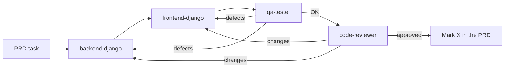

# Finanpy AI agents

Index of the AI agents that make up the Finanpy development team. Each agent is a specialist in the project stack (Python 3.14, Django 6.1.2 with Class Based Views, Django Template Language, TailwindCSS v4 through the CDN, SQLite) and follows the [PRD](../PRD.md), [CLAUDE.md](../CLAUDE.md) and the [documentation](../docs/README.md).

Each file uses the Claude Code subagent format: YAML frontmatter with `name`, `description` and `tools`, followed by the agent's instructions.

## Agents

| Agent | Role | Sprints | MCP |
|---|---|---|---|
| [backend-django](backend-django.md) | Django backend: settings, custom user, models, migrations, admin, forms, CBVs, URLs, signals, mixins | 0, 1, 3–8 | context7 |
| [frontend-django](frontend-django.md) | DTL + TailwindCSS v4: base templates, partials, screens, design system, responsiveness | 2, 3–8 | context7 |
| [qa-tester](qa-tester.md) | Functional and visual checks in the browser against the PRD and the design system | end of each sprint | playwright |
| [code-reviewer](code-reviewer.md) | Review of PEP 8, conventions, architecture rules, security and scope | after each feature, 8.4 | context7 (lookup) |
| [test-engineer](test-engineer.md) | Automated tests (Django `TestCase`) and coverage ≥ 80% | 9 | context7 |
| [devops-docker](devops-docker.md) | Environment variables, Dockerfile, Docker Compose, `.dockerignore` | 10 | context7 |

## When to use each one

### backend-django
Use it for any server-side Python code. Examples:
- create `users.User` with login by e-mail and `AUTH_USER_MODEL` (sprint 1);
- create the `Account`, `Category` and `Transaction` models, their forms and their CRUD views;
- implement `UserQuerySetMixin`, `StyledFormMixin`, the `Profile` signal, `Account.balance` and the `DashboardView` data.

### frontend-django
Use it for anything the user sees. Examples:
- `base.html` with the design system components, `base_app.html`, the sidebar and the public navbar (sprint 2);
- the list, form and confirm-delete templates for each app;
- the dashboard, empty states, pagination with filters and responsive adjustments.

### qa-tester
Use it to check in a real browser that something works and looks right. Examples:
- after each screen or feature is delivered by backend or frontend;
- the manual validation tasks in the PRD (2.6, 3.6, 5.8, 6.7, 7.8) and the visual review in 8.3;
- confirming data isolation between users (404 on another user's objects).

It does not fix code. It returns a report of defects saying which agent should fix each one.

### code-reviewer
Use it before marking tasks as `[X]` in the PRD, at the end of each sprint and in the code review of sprint 8 (8.4). It checks PEP 8, single quotes, pt-BR text, `Decimal`, audit fields, `LoginRequiredMixin` + `UserQuerySetMixin`, CSRF and scope creep. It does not edit files.

### test-engineer
Use it **only from sprint 9 on** (PRD RNF17), to write the automated tests in the PRD and measure coverage with `coverage`. When a test exposes a defect, it reports the defect to `backend-django` instead of weakening the test.

### devops-docker
Use it **only in sprint 10**, to move `SECRET_KEY`/`DEBUG`/`ALLOWED_HOSTS` to environment variables and create `.env.example`, `Dockerfile`, `docker-compose.yml` and `.dockerignore`.

## Suggested flow for each sprint



- **Sprints 0–1:** `backend-django` → `code-reviewer`. No screens yet. `qa-tester` can check the login in the admin.
- **Sprint 2:** `frontend-django` (with `backend-django` for `HomeView`, `StyledFormMixin` and settings) → `qa-tester` (2.6) → `code-reviewer`.
- **Sprints 3–8:** the full flow above.
- **Sprint 9:** `test-engineer` → `backend-django` fixes defects → `code-reviewer`.
- **Sprint 10:** `devops-docker` → `qa-tester` runs smoke tests against the container → `code-reviewer`.

## MCP servers

- **context7** (`mcp__context7__resolve-library-id`, `mcp__context7__query-docs`): the implementation agents must look up the current documentation for Django 6.x, Tailwind v4, coverage and Docker before they write code.
- **playwright** (`mcp__playwright__*`): used by `qa-tester` to drive the browser, take screenshots at 375/768/1280px and inspect the DOM, the console and network requests.

Both servers must be configured in Claude Code for these agents to work.

## Using them as Claude Code subagents

Claude Code loads subagents automatically only from `.claude/agents/` (project) or `~/.claude/agents/` (user). In this project, `.claude/agents/` holds **symbolic links** to the agent files in this folder (every `.md` except this `README.md`). `agents/` stays the only source of truth: edit the files here and the change shows up in Claude Code too.

When you add a new agent, create the link as well (PowerShell, run as administrator or with Windows Developer Mode on):

```powershell
New-Item -ItemType SymbolicLink -Path .claude\agents\<name>.md -Target (Resolve-Path agents\<name>.md)
```

The agents are loaded when a Claude Code session starts, so restart the session after you add or rename one.
